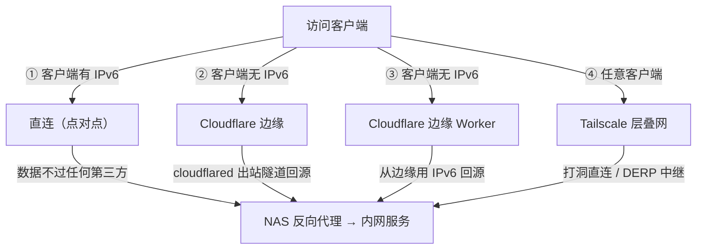

# NAS 外网访问方案速查

> 面向「想让远程客户端访问家里 NAS」的场景。
> 全文其实只围绕一个问题：**家里的 NAS，外面能不能主动连到它？**
>
> 文中的速度数字来自一台国内家宽 + 群晖 NAS 的实测环境（2026-10）。
> **速度与各自线路有关，但结论和判断方法通用。**

---

## 一、四条路径总览

> GitHub / Typora / Obsidian 等支持 Mermaid 的编辑器会自动把它渲染成流程图。

四种方法的本质区别只有一个：**数据从客户端到你家，中间经过谁。**

| | 中间经过谁 |
|---|---|
| ① 直连 IPv6 | 谁都不经过，点对点 |
| ② CF Tunnel | Cloudflare 边缘 + 一条从家里主动拉出去的隧道 |
| ③ CF Worker | Cloudflare 边缘（边缘替你回源） |
| ④ Tailscale | Tailscale 的协调服务器 + 中继（打洞成功则点对点） |

---

## 二、先判断你落在哪一格

|  | 客户端有 IPv6 | 客户端没 IPv6 |
|---|---|---|
| **家里有 IPv6** | ① 直连 —— 最快，无任何限制、不过第三方 | ③ CF Worker 或 ② CF Tunnel —— Worker 靠 CF 边缘替你连 IPv6，Tunnel 靠家里出站 |
| **家里没 IPv6** | ① 用不了（哪怕客户端有 IPv6，也连不到一个没有公网地址的家） | 只能 ② CF Tunnel / ④ Tailscale / 自建 VPS 隧道 —— 这一格最难 |

### 为什么「上下两行」才是分水岭

看这张表最重要的收获是：**左右两列内部差别不大，上下两行才是分水岭。**

- **客户端没 IPv6** 只是多一层「找个有 IPv6 的中转」—— 用 CF Worker，或者用 Tunnel 直接绕过地址问题。
- **家里没 IPv6**（且没有公网 IPv4）是**根本没地址可连**，只能靠家里主动往外拨号建连接。

所以判断一条路能不能走，**永远先看服务器侧（家里）的条件**，而不是先担心客户端有没有 IPv6。
很多人一上来就问「客户端没 IPv6 怎么办」，其实真正要先确认的是**路由器 WAN 口拿到了什么**：

- WAN 口 IP 是 `100.64.x.x` ~ `100.127.x.x`、`10.x.x.x`、`172.16~31.x.x` → **CGNAT，没有公网 IPv4**，端口映射这条路直接断
- 是真实公网 IP（如 `1.2.3.4`）→ 端口映射就是最优解，**别绕 Cloudflare**
- 再看有没有 `240e:` / `2409:` 开头的**公网 IPv6** —— 国内家宽基本都送，有它「① 直连 IPv6」就能用，比任何隧道都快

---

## 三、四种方案逐条对照

| 访问方式 | 客户端要求 | 家里要求 | 数据路径 | 参考速度 |
|---|---|---|---|---|
| ① 直连 IPv6 | 设备有公网 IPv6 | 家里有公网 IPv6（需配 DDNS） | 客户端 → 你家 NAS，中间没有任何第三方 | 最快，只受家里宽带上行限制 |
| ② CF Tunnel（Zero Trust） | 能上网就行，v4/v6 均可 | 什么都不用（cloudflared 是出站连接） | 客户端 → CF 边缘 → 隧道回到内网 | 1–2 MB/s（免费版边缘在境外）；单请求 100MB 上限 |
| ③ CF Worker（边缘回源） | 能上网就行 | 家里有公网 IPv6（边缘从 IPv6 回源） | 客户端 → CF 边缘 → Worker 用 IPv6 回你家 | ~1 MB/s（同上，卡在同一段国际出口） |
| ④ Tailscale | 装 App + 登录（必需） | 装 Tailscale 客户端 | 两端各自出站到 Tailscale，能打洞就直连，打不通走 DERP 中继 | 直连≈跑满上行；走中继延迟 150–260ms |

### ② 和 ③ 的细节差异（比速度重要）

|  | ② CF Tunnel | ③ CF Worker |
|---|---|---|
| 家里必须有什么 | 什么都不用（cloudflared 是**出站**连接） | 公网 IPv6 必须一直在（边缘要能回源） |
| 典型断线原因 | 容器挂了 / token 失效 | IPv6 前缀变了 DDNS 没跟上 / 证书过期 |
| 免费额度 | 不限请求数，单请求 100MB | 每天 10 万次请求，单请求 100MB |
| 多出来的依赖 | 一个容器 | DNS 记录 + Worker 代码 + 证书（SNI 必须对得上） |

**结论：从可靠性看 Tunnel 反而更强，不是 Worker。** Tunnel 只要一个容器活着；
Worker 要「家里 IPv6 在线 + DDNS 更新正确 + 证书没过期 + Worker 代码还在」四件事同时成立。

**② 和 ③ 速度同一档，不是原理上必然如此**，而是因为都躲不开同一段国际出口
（家 → CF 免费边缘约 250ms，边缘落在巴黎 / 伦敦 / 阿姆斯特丹）。
「慢」是「中国 → Cloudflare 免费边缘」这一段造成的，不是 Worker 或 Tunnel 造成的。

---

## 四、三条选型判据

**判据一：家里有没有「能被外面主动连到」的地址？**
有（公网 IPv4 或 IPv6）→ 能走直连类，最便宜也最快；
没有（CGNAT、或无 IPv6）→ 必须靠家里主动往外连，那就只剩下自建隧道 / 托管隧道 / 组网 VPN，免费的就只剩后两种。

**判据二：愿不愿意让远程客户端装东西？**
愿意 → 组网 VPN 最安全（一个公网端口都不开）；
不愿意 → 只能直连或隧道，不可能用 VPN。

**判据三：愿不愿意花钱？**
愿意 → 自建 VPS 中转（frp / nps / rathole）是**唯一能同时做到「快 + 不挑客户端 + 不装东西」**的方案；
不愿意 → **快 / 所有人可用 / 免费，这三个只能选两个。**

---

## 五、最容易踩的六个坑

1. **方法数量 ≠ 域名数量。** 一条隧道可以挂 N 个不同的内网服务（管理后台、监控面板、Web SSH…），
   反过来同一个服务也可能试了 N 个域名都不通。域名建得多，不等于路多。
2. **一条路试不通，别急着换域名重试。** 先确认隧道那一侧有没有配「公网域名 → 内网 host:port」的映射。
3. **「不用登录」不是隧道的自带属性。** Cloudflare Tunnel（**怎么进去**）和 Cloudflare Access
   （**谁能进去**）是两个独立开关。同一个隧道下，有的域名要邮箱验证码，有的直接放行。
4. **反代可能发生在你自己机器上，也可能发生在服务商那边**，这是两回事。
   隧道模式下反代在 Cloudflare 侧（你家 NAS 什么都不用改）；
   直连模式下反代是你自己的反向代理（监听在 `127.0.0.1:<内网服务端口>` 这一层）。数据过不过第三方，全看这一点。
5. **公网 IPv6 前缀会轮换**（运营商随时换掉 `240e:xxxx:xxxx::/64`）。
   所有依赖 IPv6 回源的方案都**必须配 DDNS**，否则直连和 Worker 会一起挂。
6. **Cloudflare 免费版对橙云流量有 100MB 单请求上限**（Tunnel 和 Worker 都一样），
   而「① 直连 IPv6」没有任何这类限制 —— 又一条「直连最优」的理由。
